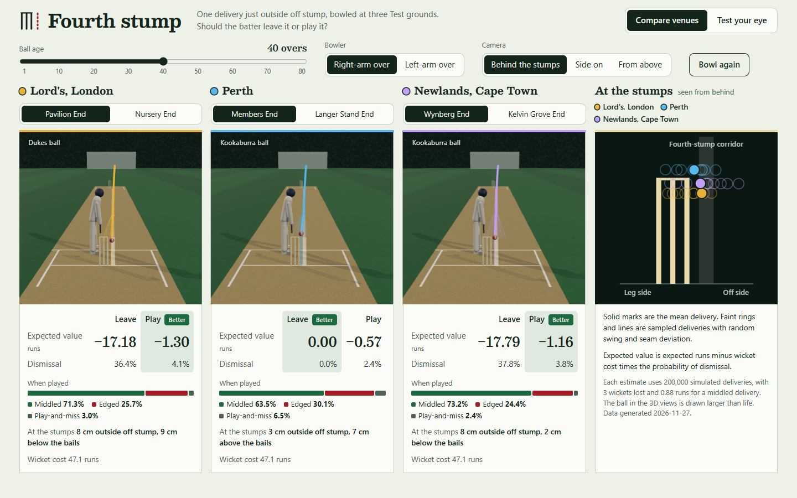
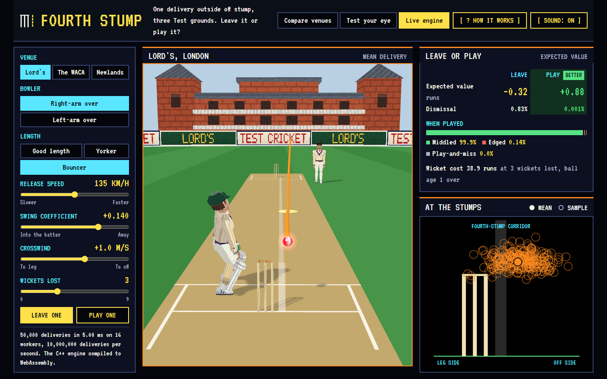
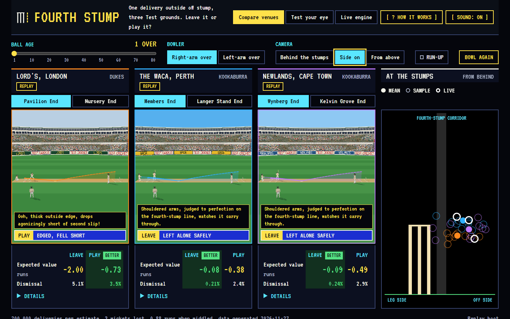

# Fourth Stump EV

[](https://github.com/zainkashifcs/fourth-stump/actions/workflows/ci.yml?query=branch%3Amain)

A fast bowler lands the ball just outside off stump, in the fourth-stump corridor. Should the batter leave it or play it? This repository treats that as an expected-value decision, runs scored against the cost of a wicket, and simulates it with a deterministic, zero-allocation C++20 Monte Carlo engine. The answer changes with the ground (Lord's, the WACA in Perth, Newlands in Cape Town), the age of the ball and the wickets lost.

**Live demo: <https://zainkashifcs.github.io/fourth-stump/viz/>**, which runs the same engine in the browser as WebAssembly.

<p>
  <a href="https://zainkashifcs.github.io/fourth-stump/viz/"></a>
  <a href="https://zainkashifcs.github.io/fourth-stump/viz/"></a>
</p>

| Headline numbers | Measured | Checked by |
|---|---|---|
| Throughput | 29.7 million deliveries per second on 16 threads, 2.9 million on one (no wind); 18.8 million and 1.8 million with wind | `make bench` |
| Kernel against the RK4 reference | worst error 5.30 mm over the envelope; published bound 8 mm | `make error-bound`, and a random search in the tests |
| Kernel speed | 17 times faster than RK4 at equal accuracy | `make bench` |
| Determinism | bit-identical output on 1, 4 and 16 threads, under either random-number policy | C++ and Python tests |
| Zero allocation | no call to `operator new` inside `simulate_batch` | a test that replaces global `operator new` |
| Tail latency | 100,000 deliveries on 16 threads: p50 3.2 ms, p99 5.1 ms, p99.9 11.4 ms | `make latency` |
| In the browser | 27 kB of WebAssembly; 50,000 deliveries at Lord's in 18.0 ms on one thread, 2.3 to 2.6 ms on 16 Web Workers | Chromium, ADR-016 |
| Data | 905 men's Tests, 1.74 million deliveries, 2001 to 2026, from Cricsheet | `uv run python -m scraper` |

Native figures are from one laptop (Intel Core i5-13450HX), not an idle machine; the conditions are under [Systems and performance](#systems-and-performance).

## Contents

- [What is in the repository](#what-is-in-the-repository)
- [The model](#the-model)
- [The decision](#the-decision)
- [Systems and performance](#systems-and-performance)
- [Data and calibration](#data-and-calibration)
- [The visualisation](#the-visualisation)
- [Design decisions](#design-decisions)
- [Known limits](#known-limits)
- [Tests](#tests)
- [Constants and sources](#constants-and-sources)
- [Third-party code](#third-party-code)

## What is in the repository

- **The engine**: one C++20 header with no dependencies. `simulate_batch` simulates a batch of deliveries into caller-owned buffers, evaluating both actions on each delivery. OpenMP is optional at compile time.
- **The reference trajectory**: RK4 integration of the full equation of motion, used only to measure the engine's error.
- **A Python binding** (pybind11) with zero-copy views and the GIL released, the Cricsheet scraper, the run-expectancy table and the calibrator.
- **The page**: a static Three.js page in `viz/` that reads trajectories precomputed by the engine, plus the engine itself compiled to WebAssembly for the live view.

### Quick start

Requires g++ with C++20 and OpenMP, [uv](https://docs.astral.sh/uv/), `make` (on Windows, `mingw32-make` from Git Bash or an MSYS2 shell), and Node for the page tests (CI uses Node 24).

```
uv sync                  # Python environment
make test                # C++ tests, then the Python tests against the freshly built binding
node --test viz/tests/   # the page's tests, including the committed WebAssembly build
make bench               # throughput, the two random-number policies, and the RK4 comparison
make error-bound         # the error-bound table
make latency             # batch latency percentiles and the false-sharing table
make bench-ipc           # Batch.simulate's views against simulate's new arrays
make viz-data            # regenerate viz/data/trajectories.json and viz/data/live.json
make wasm                # rebuild viz/wasm/ (needs Emscripten; the output is committed)
cd viz && python -m http.server 8000     # the page, at http://localhost:8000/
```

The data pipeline, which needs network access once and then runs from its cache:

```
uv run python -m scraper                 # download and parse Cricsheet (cached)
uv run python -m calibrator.run_expectancy
uv run python -m calibrator.calibrate    # about 20 minutes
```

| Path | Contents |
|---|---|
| `cpp/include/fourth_stump_engine.hpp` | The whole engine |
| `cpp/include/fourth_stump_reference.hpp` | The RK4 reference trajectory |
| `cpp/include/fourth_stump_envelope.hpp` | The envelope and the sweep that measures the bound |
| `cpp/tests`, `cpp/bench` | Tests; throughput and latency benchmarks, the error-bound tool, the Windows power-throttling opt-out |
| `cpp/python` | The pybind11 binding's source |
| `cpp/wasm` | The C interface compiled to WebAssembly for the page |
| `fourth_stump/` | Python package: the binding, venue conditions, the binding's benchmark, the page's data export |
| `scraper/`, `calibrator/` | Cricsheet pipeline, run expectancy, calibration |
| `data/` | Committed results derived from Cricsheet: calibration moments, calibrated venues, the run-expectancy table |
| `viz/` | The page; `viz/wasm` holds the built engine, `viz/blender` the scripts that build the models in `viz/assets` |
| `.github/workflows` | CI, and the GitHub Pages deployment |
| `ADR/`, `GLOSSARY.md` | Sixteen design decisions and the project's vocabulary |

## The model

A delivery is a point mass with three degrees of freedom. It has no spin and no orientation. Coordinates are right-handed with the origin at the base of the batter's middle stump: `+x` is the off side of a right-hander, `+y` points up the pitch towards the bowler (whose stumps are at 20.12 m), and `+z` is up. A delivery travels in `−y`. The fourth-stump corridor is `0.18 m ≤ x ≤ 0.28 m`.

### Equation of motion

In flight the ball feels gravity, quadratic drag, and a seam side force that acts horizontally and perpendicular to its velocity relative to the air (ADR-004). Wind is one constant vector `w` per venue, and every aerodynamic force uses the air-relative velocity `u`, so wind changes drag and swing together.

```math
\ddot{\mathbf{r}} = -g\,\hat{\mathbf{z}} \;-\; k\,\lVert\mathbf{u}\rVert\,\mathbf{u} \;+\; k_s\,\lVert\mathbf{u}\rVert^{2}\,\hat{\mathbf{s}},
\qquad \mathbf{u} = \dot{\mathbf{r}} - \mathbf{w}
```

```math
k = \frac{\rho A C_d}{2m}, \qquad k_s = \frac{\rho A C_s}{2m}, \qquad \hat{\mathbf{s}} = \frac{\hat{\mathbf{z}} \times \mathbf{u}_h}{\lVert\mathbf{u}_h\rVert}
```

Here `u_h` is the horizontal part of `u`, `s` is the horizontal direction perpendicular to it, `A` and `m` are the ball's cross-section and mass, `C_d` is the drag coefficient and `C_s` is the swing coefficient, whose sign gives the direction of swing. The engine uses g = 9.81 m/s², air density ρ = 1.2 kg/m³, a ball of radius 36 mm and mass 156 g, and C_d = 0.45.

There is no Magnus term. Seam-bowling swing comes from the angled seam tripping the boundary layer on one side of the ball, not from spin, and a spin vector would be a free parameter that the data cannot calibrate. Spin bowling is out of scope.

Each delivery makes three random draws, in a fixed order, from its own stream: its swing coefficient `C_s ~ N(mean, σ_swing)`, its seam deviation `δ ~ N(0, σ_seam)`, and its vertical restitution `e_z ~ N(mean, σ_ez)`, clamped to between 0 and 1 (variable bounce).

### The kernel: closed form in distance, not integration in time

The engine does not integrate that equation at run time. Quadratic drag has no exact closed-form solution in three dimensions, so the kernel uses the flat-trajectory approximation: a delivery is nearly straight, so distance down the pitch `d` replaces time as the independent variable (ADR-005). In the frame moving with the wind, write `u` for the forward air speed and `θx = ux/u`, `θz = uz/u` for the path's sideways and vertical slopes.

**Speed decays exponentially with distance.** Drag gives du/dt ≈ −k u², and dd = u dt, so

```math
\frac{du}{dd} \approx -k\,u \quad\Rightarrow\quad u(d) = u_0\,e^{-kd}, \qquad t(d) = \frac{e^{kd}-1}{k\,u_0}
```

**Swing is parabolic in distance.** In the rate of change of the sideways slope the drag terms cancel exactly, leaving

```math
\frac{d\theta_x}{dd} = \frac{k_s\,\lVert\mathbf{u}\rVert^{2}\,\lVert\mathbf{u}_h\rVert}{u^{3}} \approx k_s
\quad\Rightarrow\quad
x(d) = x_0 + \theta_{x0}\,d + \tfrac{1}{2}\,k_s\,d^{2}
```

Drag and the side force both scale with speed squared, so however much the ball slows, it turns by the same angle per metre. This is why a ball swings late: the sideways movement grows with the square of distance. It is also why swing at a given distance does not depend on pace, which a test checks on the RK4 reference at 120 and 150 km/h.

**Gravity has a closed form with one `exp`.** dθz/dd ≈ −g/u² = −g e^(2kd)/u₀², so

```math
z(d) = z_0 + \theta_{z0}\,d - \frac{g\,\left(e^{2kd} - 1 - 2kd\right)}{4k^{2}u_0^{2}}
```

The kernel adds second-order corrections (means of products of the path's slopes over a flight leg) that cost no extra transcendental call; they took the worst error from about 24 mm to 5.3 mm. Wind along the pitch makes the arrival distance the root of a Lambert-W-type equation, which the kernel solves with two fixed Newton steps; this is why the windy throughput is lower.

**The reference.** RK4 integration of the full equation of motion above is the reference trajectory that the kernel is checked against. The kernel and the reference share one bounce map and the same random draws, so the comparison is end to end, at the plane of the batter's stumps. Over the envelope below the worst error the kernel shows is **5.30 mm**; the published bound is **8 mm**, which leaves room for points the grid and the random search did not hit.

The envelope: 120 to 150 km/h; swing coefficient up to 0.30 either way; wind up to 5 m/s from any direction; release up to 1.0 m either side of the stumps and 1.9 to 2.4 m high; any length from a full toss to 10 m from the batter's stumps; line from 0.2 m down the leg side to 0.6 m outside off. A swing coefficient of 0.30 moves the ball about 77 cm over the pitch, far more than a real delivery. Outside the envelope the kernel promises nothing.

<details>
<summary>Worst error against the reference, by swing coefficient and wind</summary>

| Swing coefficient | Wind (m/s) | Deliveries | Worst error at the bat (mm) | Worst error at the stumps (mm) |
|---|---|---|---|---|
| 0.00 | 0 | 2,880 | 0.57 | 0.62 |
| 0.00 | 5 | 23,040 | 0.86 | 0.92 |
| 0.10 | 0 | 5,760 | 0.86 | 0.97 |
| 0.10 | 5 | 46,080 | 1.39 | 1.51 |
| 0.20 | 0 | 5,760 | 1.51 | 1.79 |
| 0.20 | 5 | 46,080 | 2.59 | 3.01 |
| 0.30 | 0 | 5,760 | 2.49 | 3.07 |
| 0.30 | 5 | 46,080 | 4.49 | 5.30 |

From `make error-bound`. The worst case is the largest swing, with wind, on a full toss, where one flight leg runs the whole pitch. A first version of the sweep had no full tosses and a fixed release position and reported 4.3 mm; a review found deliveries inside the stated envelope at 5.1 mm, so the sweep was widened and the bound republished (ADR-005).

</details>

### The bounce

The bounce is an instantaneous map from incoming to outgoing velocity, not an equation integrated through the contact (ADR-006). With `n` the pitch's surface normal and `v_n = v · n` the speed into the pitch (negative):

```math
\mathbf{v}' = R_{\delta}\Big[\,\kappa\,\big(\mathbf{v} - v_n\,\hat{\mathbf{n}}\big) - e_z\,v_n\,\hat{\mathbf{n}}\,\Big],
\qquad \hat{\mathbf{n}} = (\sin\tau,\, 0,\, \cos\tau)
```

- **Vertical restitution `e_z`**: the fraction of the speed into the pitch that the ball keeps. Each delivery draws its own around the venue's mean (variable bounce), so a delivery that usually clears the bails sometimes keeps low.
- **Pace retention κ = 0.887**: the fraction of the speed along the pitch that it keeps, a published constant, never fitted.
- **Seam deviation δ**: `R_δ` turns the outgoing direction sideways by a random angle drawn for each delivery.
- **Slope τ**: zero at Perth and Newlands. At Lord's the normal is tilted by the 2.5 m fall across the ground, 1.09° (0.0191 rad), which moves a good-length delivery 4.3 cm sideways by the stumps (3.2 cm for a fuller one, 5.7 cm for a shorter one). From the Pavilion End the slope takes the ball into a right-hander; from the Nursery End, away.

### The batter and the outcomes

The batter tracks the true path until one reaction time (0.2 s) before the ball reaches the bat, then commits the bat to where a delivery with the venue's mean swing, no seam deviation and the mean bounce would arrive (ADR-008). Only movement after that commit point can beat the bat. The batter does not infer this delivery's swing coefficient from the curve already seen, which understates a good batter.

The **gap** is the sideways distance, at the popping crease, between where the batter expected the ball and where it arrives (ADR-007). With a 108 mm bat and a 36 mm ball radius:

- **Leave**: no runs, and a dismissal only if the ball goes on to hit the stumps.
- **Play**, by the size of the gap:
  - under 44 mm (the bat's half-width less a 10 mm edge band): **middled**, scoring the runs a middled delivery is worth (0.88 runs, set so that simulated runs per ball match history);
  - from 44 mm to 90 mm (the half-width plus the ball's radius): **edged**. Only an outside edge can reach the slip cordon. It **carries** if it is still above catching height 13 m back, and a carrying edge is caught with the venue's catch conversion. A thin edge keeps more pace than a thick one;
  - 90 mm or more: **play-and-miss**, a dismissal if the ball goes on to hit the stumps.

Only the sideways gap decides middled, edged or play-and-miss: the height the ball arrives at plays no part, except in the stumps check and the carry. Out of scope by decision: LBW, catches off middled deliveries, run-outs, hit wicket, spin bowling and a second bounce.

## The decision

For each action the engine estimates

```math
\mathrm{EV}(\text{action}) = \mathbb{E}[\,\text{runs} \mid \text{action}\,] - \lambda(w, a)\, P(\text{dismissal} \mid \text{action})
```

where `λ(w, a)` is the wicket cost in runs with `w` wickets lost and a ball `a` overs old. Leaving scores nothing, so EV(leave) = −λ P(bowled | leave). Playing scores the middled runs with the probability of middling, and its dismissal probability is catch conversion times the probability of an edge that carries, plus the probability of a play-and-miss that hits the stumps. Leave and play are evaluated on the same simulated delivery with the same random draws (common random numbers), so the noise they share cancels in the comparison. This is a comparison of two expected values with a wicket cost, nothing more.

### The wicket cost

`V(w, a)` is the run expectancy: the expected runs for the rest of the innings, from the start of an over, with `w` wickets lost (0 to 9) and a ball `a` overs old (1 to 80) (ADR-011). Each legal ball in state (w, a) is a wicket with probability `p(w, a)` and adds `r(w, a)` runs on average, both estimated from Cricsheet. An over is six legal balls; after it the ball age advances by one, and a new ball is assumed every 80 overs, so ball age 80 is followed by ball age 1. The innings ends at ten wickets, so V(10, a) = 0.

For one ball, with `V'` the value after it,

```math
V(w) = r(w, a) + \big(1 - p(w, a)\big)\,V'(w) + p(w, a)\,V'(w + 1)
```

Over one over this is linear in the vector of values at the next ball age, with `B_a` the one-ball matrix (1 − p on the diagonal, p above it):

```math
\mathbf{V}_a = \mathbf{c}_a + M_a\,\mathbf{V}_{a+1}, \qquad M_a = B_a^{6}, \qquad \mathbf{c}_a = \sum_{k=0}^{5} B_a^{k}\,\mathbf{r}_a, \qquad \mathbf{V}_{81} = \mathbf{V}_{1}
```

Ball age is cyclic, so the table is the fixed point of this recursion. Composing the 80 overs of a ball's life gives V₁ = C + P V₁, a 10 × 10 linear system solved directly; the other 79 ball ages follow by walking the cycle backwards. The wicket cost is

```math
\lambda(w, a) = V(w, a) - V(w + 1, a)
```

"Overs remaining" was rejected as a state: with nothing after the close of play, a wicket near stumps would cost nothing, which is the opposite of Test cricket. Sparse cells (many wickets down, an old ball) are shrunk towards the rate for their wickets lost over all ball ages, with a prior weight of 1,200 legal balls.

Run expectancy and wicket cost from `data/run_expectancy.json`, in runs:

| Wickets lost `w` | V(w, 1) | λ(w, 1) | λ(w, 40) | λ(w, 80) |
|---|---|---|---|---|
| 0 | 315 | 43.7 | 34.5 | 42.3 |
| 1 | 271 | 38.1 | 38.6 | 37.9 |
| 2 | 233 | 38.1 | 44.3 | 38.4 |
| 3 | 195 | 38.9 | 47.1 | 39.2 |
| 4 | 156 | 40.0 | 41.2 | 39.8 |
| 5 | 116 | 35.4 | 37.9 | 35.9 |
| 6 | 81 | 26.9 | 29.7 | 27.3 |
| 7 | 54 | 22.0 | 21.3 | 21.7 |
| 8 | 32 | 18.3 | 17.4 | 18.5 |
| 9 | 14 | 13.8 | 13.9 | 13.6 |

### Results for the standard delivery

From `viz/data/trajectories.json`, which the page reads. Each scenario is the same release under each venue's conditions: right-arm over the wicket from 0.75 m to the off side of middle stump and 2.08 m high, 135 km/h, good length, aimed to pass middle stump without swing or wind, with 3 wickets lost. Each probability is estimated from 200,000 deliveries. The rows below are right-arm over from each venue's first bowling end (the Pavilion End at Lord's, the Members End at the WACA, the Wynberg End at Newlands). Expected values are in runs.

| Venue | Ball age (overs) | λ(3, a) | P(dismissal), leave | P(dismissal), play | EV(leave) | EV(play) | Better |
|---|---|---|---|---|---|---|---|
| Lord's | 1 | 38.9 | 0.051 | 0.035 | −2.00 | −0.73 | play |
| Lord's | 10 | 41.7 | 0.106 | 0.037 | −4.41 | −0.93 | play |
| Lord's | 40 | 47.1 | 0.362 | 0.038 | −17.07 | −1.18 | play |
| Lord's | 80 | 39.2 | 0.585 | 0.035 | −22.90 | −0.75 | play |
| The WACA | 1 | 38.9 | 0.002 | 0.024 | −0.08 | −0.38 | leave |
| The WACA | 10 | 41.7 | 0.023 | 0.027 | −0.96 | −0.58 | play |
| The WACA | 40 | 47.1 | 0.116 | 0.029 | −5.45 | −0.81 | play |
| The WACA | 80 | 39.2 | 0.136 | 0.029 | −5.33 | −0.57 | play |
| Newlands | 1 | 38.9 | 0.002 | 0.029 | −0.09 | −0.49 | leave |
| Newlands | 10 | 41.7 | 0.042 | 0.033 | −1.74 | −0.76 | play |
| Newlands | 40 | 47.1 | 0.330 | 0.037 | −15.56 | −1.11 | play |
| Newlands | 80 | 39.2 | 0.415 | 0.037 | −16.26 | −0.80 | play |

Across all 108 scenarios in the file (three venues, nine ball ages from 1 to 80, two arms, two ends), leaving is better in four, all with a new ball (ball age 1) at the WACA and Newlands: right-arm from the first end and left-arm from the second. As the ball ages, the chance that a left ball hits the stumps rises at every venue: the release is aimed at middle stump, and swing fades with ball age. These are results of the model under its assumptions (see [Known limits](#known-limits)), not advice to batters.

## Systems and performance

### Conditions

Machine: Intel Core i5-13450HX (10 cores, 16 threads), Windows 11, g++ 16.2 (MSYS2 UCRT64).
Flags: `-std=c++20 -O3 -march=native -ffp-contract=off -fopenmp`. No `-ffast-math`.
`-march=native` means these figures belong to this machine.

Measured on 27 November 2026 with a browser and a game open: about 5 to 15% total CPU load, Balanced power plan, on mains, with Windows power throttling (EcoQoS) opted out. The benchmark tools opt out of power throttling themselves, because it otherwise slowed a process started from a background shell by more than three times a few seconds into a run. Every benchmark ran three times; each figure is the median of the three, and the runs agreed within 5% except where a range is given. Earlier figures on the same machine idle were 30.8 million deliveries per second on 16 threads and 3.1 million on one. Earlier the same day, in the same conditions, single-thread batches ran about 45% slower (about 500 ns per delivery) on every core. The old and new headers timed the same back to back then, so that was the machine's state, not the code.

Each delivery in the throughput figures is the full pipeline: three normal draws, two flight legs, the bounce, the batter's expected arrival, and the outcome of both leaving and playing.

### Native C++20

| Measure | 1 thread | 16 threads |
|---|---|---|
| Throughput, no wind (4,194,304 deliveries) | 2.9 million per second (341.5 ns per delivery) | 29.7 million per second (33.7 ns) |
| Throughput, wind (4, 1) m/s (1,048,576 deliveries) | 1.8 million per second (549.0 ns) | 18.8 million per second (53.3 ns) |
| Latency, one batch of 100,000 deliveries | p50 33.3 ms, p99 35.7 ms, p99.9 37.1 ms | p50 3.23 ms, p99 5.13 ms, p99.9 11.4 ms |
| Latency, one batch of 10,000 deliveries | p50 3.29 ms, p99 4.01 ms, p99.9 5.23 ms | p50 0.47 ms, p99 0.90 ms, p99.9 1.69 ms |

| Kernel against RK4 (one thread, the same 4,000 deliveries, with wind) | ns per delivery | Worst error (mm) | Kernel speed-up |
|---|---|---|---|
| Closed-form kernel | 218 | 0.403 | 1x |
| RK4, 20 ms step | 1,858 | 0.551 | 9x |
| **RK4, 10 ms step** | **3,673** | **0.137** | **17x** |
| RK4, 5 ms step | 7,356 | 0.035 | 34x |
| RK4, 1 ms step | 36,356 | 0.001 | 167x |

"Worst error" here is against RK4 at a 0.01 ms step. The fair comparison is the 10 ms row: the coarsest RK4 step that is at least as accurate as the kernel on these deliveries. The larger figures compare against an RK4 that is far more accurate than the kernel.

- **Determinism.** Each delivery's random stream is a function of the seed and its delivery index only, never of a thread. Per-delivery streams are required, not just convenient: Ziggurat sampling rejects, so deliveries consume a varying number of draws. Results are written by index and totals are integer counts. The promise is bit-reproducible across thread counts on one binary, and statistically reproducible across platforms, because the platform `exp` can differ in the last bit (ADR-003).
- **Zero allocation.** The caller owns 64-byte-aligned structure-of-arrays buffers and the engine writes into them (ADR-012). The test sees `operator new` only: it cannot see `malloc` calls inside the OpenMP runtime, so it warms the runtime up first and runs at a fixed thread count.
- **Common random numbers.** Measured in the tests: comparing two nearby conditions on the same seed cuts the variance of the difference by about 30 times against independent seeds. Comparing leave with play on the same deliveries cuts it by about 1.3 times.
- **Two random-number policies** (ADR-014). The default is xoshiro256\*\* seeded per delivery with Ziggurat normals; calibration ran on it. `simulate_batch<PhiloxBoxMuller>` instead uses the counter-based Philox4x32-10 generator, keyed with the seed and with the delivery index in the counter, and Box-Muller normals. Both draw 64 deliveries at a time into aligned arrays on the thread's stack, and both give bit-identical output on 1, 4 and 16 threads. The counter-based policy is not faster end to end in any way that matters: the draws are about 4% of a delivery (about 15 ns of 340), and the full pipeline came out 0 to 2% faster.
- **False sharing.** Counting outcomes into per-thread slots packed back to back is about 1.7 times as slow on 16 threads as one 64-byte slot per thread. The engine itself keeps no per-thread counters; its only shared writes are the outcome arrays, each thread writing one contiguous run of indices that starts on a cache-line boundary.

<details>
<summary>Throughput by batch size</summary>

| Conditions | Batch size | Threads | Median ns per delivery | Million deliveries per second |
|---|---|---|---|---|
| No wind | 4,096 | 1 | 345.6 | 2.9 |
| No wind | 4,096 | 16 | 61.1 | 16.4 |
| No wind | 65,536 | 1 | 343.4 | 2.9 |
| No wind | 65,536 | 16 | 43.4 | 23.0 |
| No wind | 1,048,576 | 1 | 342.0 | 2.9 |
| No wind | 1,048,576 | 16 | 34.4 | 29.1 |
| No wind | 4,194,304 | 1 | 341.5 | 2.9 |
| No wind | 4,194,304 | 16 | 33.7 | 29.7 |
| Wind (4, 1) m/s | 1,048,576 | 1 | 549.0 | 1.8 |
| Wind (4, 1) m/s | 1,048,576 | 16 | 53.3 | 18.8 |

Default random-number policy, median of three runs. On 16 threads some rows moved between runs: 57.8 to 70.9 ns at 4,096 deliveries, 37.4 to 48.7 ns at 65,536, and 50.7 to 54.2 ns with wind. The earlier idle-machine figures for this table were 30.8 million per second at 4,194,304 deliveries on 16 threads and 3.1 million on one.

</details>

<details>
<summary>Batch latency in full</summary>

Wall time of one `simulate_batch` call, timed call by call after warm-up calls (`make latency`). Percentiles are nearest-rank; with 500 samples, p99.9 is the slowest call. Each cell is the median of three runs.

| Deliveries | Threads | Samples | p50 | p99 | p99.9 |
|---|---|---|---|---|---|
| 10,000 | 1 | 3,000 | 3.29 ms | 4.01 ms | 5.23 ms |
| 100,000 | 1 | 500 | 33.3 ms | 35.7 ms | 37.1 ms |
| 10,000 | 16 | 3,000 | 0.47 ms | 0.90 ms | 1.69 ms |
| 100,000 | 16 | 500 | 3.23 ms | 5.13 ms | 11.4 ms |

Every p50 agreed within 1% across the three runs, and every p99 within 4% except 16 threads at 10,000 deliveries, which ranged from 0.81 to 1.02 ms. The p99.9 column moved more: 5.05 to 5.47 ms and 36.2 to 43.8 ms on one thread, and 1.19 to 1.88 ms and 10.4 to 14.0 ms on 16.

</details>

<details>
<summary>The two random-number policies, and what vectorises</summary>

Full pipeline, 1,048,576 deliveries per batch, with the two policies alternating repetition by repetition so that any drift in the machine hits both:

| Conditions | Threads | xoshiro256\*\* + Ziggurat (ns per delivery) | Philox4x32-10 + Box-Muller (ns per delivery) | Philox / xoshiro |
|---|---|---|---|---|
| No wind | 1 | 339.8 | 333.8 | 0.98 |
| No wind | 16 | 37.2 | 36.9 | 0.99 |
| Wind (4, 1) m/s | 1 | 548.8 | 539.3 | 0.98 |
| Wind (4, 1) m/s | 16 | 51.9 | 51.8 | 1.00 |

| Draws alone, 1 thread | xoshiro256\*\* + Ziggurat | Philox4x32-10 + Box-Muller | Philox / xoshiro |
|---|---|---|---|
| ns per delivery (3 normals) | 15.1 | 14.1 | 0.93 |
| ns per normal | 5.04 | 4.71 | 0.93 |

Each cell is the median of three runs. On 16 threads with wind the runs ranged from 51.3 to 57.7 ns for xoshiro and from 51.5 to 56.0 ns for Philox, but within each run the ratio stayed between 0.97 and 1.00 on every row. The Philox pipeline came out 0 to 2% faster, a little more than the 1 ns its cheaper draws explain. Pinned to one core, its draws were 5% dearer, not cheaper (table below). Either way, the policy barely moves throughput.

What vectorises, from `-fopt-info-vec` and from scalar and vectorised builds of the same code pinned to one performance core (mean of two runs):

| Draw stage, ns per delivery | Scalar | Vectorised (AVX2) |
|---|---|---|
| Philox4x32-10 generator | 8.0 | 8.5 |
| Box-Muller transform (2 logs, 2 sincos, 2 square roots) | 23.6 | 7.0 |
| Philox4x32-10 + Box-Muller | 34.0 | 15.2 |
| xoshiro256\*\* + Ziggurat | 14.4 | does not vectorise |

The generator vectorises but is no faster: AVX2 has no 32×32→64-bit multiply across all eight 32-bit lanes, so GCC reshuffles the words every round. The transform vectorises only because `log` and `sin`/`cos` are branchless polynomials in the header. With the standard library's functions the loop stays scalar, because this toolchain has no vector maths library and `-ffast-math` is banned. The polynomials match the standard library to 2.2 × 10⁻¹⁶ relative (log) and 6.9 × 10⁻¹⁶ absolute (sin, cos) over every input the draws can produce, and scalar and vectorised builds give the same bits. The Ziggurat rejects, so its loop cannot vectorise, and neither does the per-delivery kernel.

</details>

<details>
<summary>False sharing</summary>

| Counting path | Threads | ns per delivery |
|---|---|---|
| Per-thread `Summary`, packed (56-byte slots) | 1 | 1.223 |
| Per-thread `PaddedSummary` (64-byte slots) | 1 | 1.226 |
| Per-thread `Summary`, packed (56-byte slots) | 16 | 0.416 |
| Per-thread `PaddedSummary` (64-byte slots) | 16 | 0.251 |
| The engine's `summarize` (serial) | 1 | 1.309 |

Over three runs the packed slots took 0.37 to 0.43 ns per delivery on 16 threads against 0.20 to 0.25 for the padded ones. On one thread the two layouts cost the same. The cache-line audit in the header finds that the only shared writes in `simulate_batch` are the outcome arrays. Because work is handed out 64 deliveries at a time, each thread's run of indices starts on a cache-line boundary of the aligned buffers.

</details>

### The Python binding

`fourth_stump.Batch` owns one aligned `BatchStorage` (ADR-015). `Batch.sample` fills its releases. `Batch.simulate` runs the engine into its outcomes and returns them as read-only NumPy views of that storage, which is reused on every call. Every engine call in the binding runs with the GIL released.

- **Lifetime rule.** Each view's base is the `Batch`, so the storage lives until the `Batch` and every view of it are gone.
- **Aliasing rule.** A view shows the storage, not a snapshot: the next `simulate` or `sample` rewrites it, so copy a result to keep it.
- **The older call.** `simulate` keeps its signature and returns new, writeable arrays. It never copied either: it always wrote straight into the arrays it allocated. What `Batch` saves is allocating nine arrays per call and the page faults of writing them for the first time: 4 to 7 ns per delivery.
- **Trust boundary.** The engine does not validate its inputs; the binding rejects releases that are not finite, start at or below the pitch, or do not travel down it.

<details>
<summary>Batch.simulate against simulate</summary>

| Deliveries | `simulate` (µs per call) | `Batch.simulate` (µs per call) | Saved per call (µs), three runs | Saved per delivery (ns), median |
|---|---|---|---|---|
| 1,000 | 152 | 146 | 5.7 to 9.1 | 6.1 |
| 10,000 | 849 | 798 | 30 to 82 | 5.1 |
| 100,000 | 5,007 | 4,288 | 625 to 1,542 | 7.2 |
| 1,000,000 | 42,042 | 37,598 | 3,898 to 4,512 | 4.4 |

Every core, median of 31 calls with the two calls alternating, and each cell the median of three runs (`make bench-ipc`). Per-call times at 10,000 and 100,000 deliveries moved by up to 36% between runs (`simulate` took 798 to 1,018 µs and 4,335 to 5,885 µs). The saving was positive in every row of every run.

</details>

### WebAssembly in the browser

The same engine header is compiled by Emscripten to 27 kB of WebAssembly (`make wasm`; the build is committed) and run in a pool of Web Workers, one module instance each, with no shared memory (ADR-016). Threads were not an option: they need `SharedArrayBuffer`, which needs cross-origin isolation headers that GitHub Pages cannot send. A batch is split into pieces of consecutive delivery indices and each worker returns integer outcome counts, so the result is identical for any number of workers. The module links with no heap, so nothing is allocated at start-up or per run.

| 50,000 deliveries | Lord's (ms) | Newlands, wind (4, 1) m/s (ms) |
|---|---|---|
| One instance, in the page | 18.0 | 28.1 |
| 2 workers | 9.3 to 9.6 | 14.5 to 14.8 |
| 4 workers | 4.8 to 5.3 | 7.4 to 8.2 |
| 8 workers | 3.1 to 3.3 | 4.6 to 5.0 |
| 16 workers | 2.3 to 2.6 | 3.0 to 3.4 |

In a visible Chromium window on the machine above, median of 21 runs after 20 warm-up runs, ranges over two sessions, timed on a page that does nothing else. One instance runs at 360 to 380 ns per delivery, within 10 to 15% of one native thread. In the demo itself the workers share the processor with the 3D scene: its status line showed 4 to 10 ms on 16 workers on a quiet machine, and far more when other programs were busy or the window was in the background. Headless Chromium started from a background shell ran about five times slower, which looks like the Windows power throttling described above.

Against the native engine the agreement is statistical, as ADR-003 promises across platforms: all 30 published probabilities were reproduced within four standard errors (the largest difference was 1.9). With the same seed, 100,000 deliveries gave identical outcome counts in all six venue and arm cases.

## Data and calibration

Ball-by-ball data for 905 men's Tests (1.74 million deliveries, 2001 to 2026) comes from [Cricsheet](https://cricsheet.org/), made available under the [Open Data Commons Attribution License (ODC-By 1.0)](http://opendatacommons.org/licenses/by/1.0/). The files under `data/` (`calibration_moments.json`, `calibrated.json`, `run_expectancy.json`) are derived from it; the downloaded archive stays in the git-ignored `data/cache/` and is not redistributed. Cricsheet has no line, length, batter action or bowler type, so nothing here depends on observing them; overs 1 to 25 of each innings (the new-ball window) stand in for pace bowling.

**Calibration.** Historical dismissal rates are seen only on deliveries a batter chose to play. The calibrator simulates a batter who follows a leave rule and matches two rates per venue on that population: the bowled rate identifies the spread of seam deviation, and the caught rate identifies catch conversion, the share of carrying edges that are caught (ADR-010).

| Venue | New-ball deliveries | Seam deviation spread | Catch conversion | Mean restitution `e_z` (assumed) |
|---|---|---|---|---|
| Lord's | 23,715 | 0.42° (0.40° to 0.44°) | 0.73 (0.61 to 0.86) | 0.52 |
| The WACA, Perth (13 Tests at the WACA, 6 at Perth Stadium) | 10,949 | 0.50° (0.45° to 0.54°) | 0.18 (0.14 to 0.24) | 0.62 |
| Newlands | 14,785 | 0.41° (0.38° to 0.44°) | 0.47 (0.39 to 0.59) | 0.56 |

Intervals are 95% bootstrap intervals for sampling noise in the counts only.

What the calibration does and does not show:

- On synthetic data the calibrator recovers the seam deviation spread within 10% in 9 of 9 fits and catch conversion in 8 of 9 (the ninth is 10.3% high). A fit that ignores the leave rule understates catch conversion by 30% to 50%.
- The swing spread did not recover on synthetic data (1 fit in 12), so it is fixed, not fitted.
- The data does not separate the venues' seam deviation.
- Restitution and swing spread could not be identified from two rates and are fixed at assumed values. The fitted values are conditional on them: a restitution prior wrong by 0.05 moves catch conversion by about a factor of two.
- Perth's catch conversion of 0.18 is not credible as a physical number. It says the assumed restitution of 0.62, with a slip cordon at a fixed distance, produces more carrying edges than the scorebook supports. An earlier fit that let restitution vary put it near 0.50 at all three venues; that fit is kept in `data/calibrated.json`.
- The caught target is all catches, an upper bound on cordon catches. Counting only catches by the wicketkeeper gives catch conversions about 2.5 times smaller.
- The fitted values are effective values for this outcome model, not measurements of the pitches.

**Assumptions that are not fitted:**

- Each venue's mean swing coefficient, how fast swing fades with ball age (a Dukes ball is given a longer half-life than a Kookaburra), and each venue's wind.
- Each venue's mean restitution and swing spread (see above), and how much restitution varies between deliveries (a standard deviation of 0.025 at Perth, 0.03 at Lord's and 0.035 at Newlands).
- The leave rule: leave when the expected arrival is more than 0.30 m outside off stump.
- The population of releases used for calibration: right-arm over the wicket to a right-hander.
- The slip cordon's distance (13 m), the pace an edge keeps, and the width of the edge band on the bat.
- A new ball every 80 overs; declarations, the follow-on and the match situation are ignored in the wicket cost, which overstates run expectancy for strong positions.
- "The WACA, Perth" pools 13 Tests at the WACA with 6 at Perth Stadium, because Perth Stadium alone has too few new-ball deliveries to fit. The pitches differ, so Perth's fitted values describe neither ground exactly.

## The visualisation

A static Three.js page in `viz/`, styled as a retro Test-match broadcast, with no build step. It is published to GitHub Pages by `.github/workflows/pages.yml` on every push to `main`.

- **Compare venues.** The standard delivery at the three grounds, read from `viz/data/trajectories.json` (108 precomputed scenarios), with a ball-age slider and toggles for the bowler's arm and the bowling end.
- **Test your eye.** The bowler runs in and the picture freezes at the bounce. Choose leave or play, then see the true path, the outcome and the expected value of both actions.
- **Live engine.** The engine itself, as WebAssembly. The venue, the bowler's arm, the delivery length (good length, yorker or bouncer), the release speed, the swing coefficient, the crosswind and the wickets lost are the visitor's, and every change simulates 50,000 deliveries. Without WebAssembly the view shows the nearest precomputed scenario instead.

The low-poly models are built, painted, rigged and animated by Python scripts run in Blender (`viz/blender/`) and exported as glTF to `viz/assets/`. The flight up to the bat is the engine's trajectory. What the ball, bat and stumps do after contact is illustration, not simulation, as are the stadium, the crowd and the commentary; the ball is drawn larger than life.

- **The bat on the ball.** In the last 0.14 s of a played ball the bat's face (middled) or outside edge (edged) is steered onto the ball's position at the instant it reaches the bat, and both hands are re-solved onto the handle every frame. The contact point may slide within the blade's middle third, the batter shifts and bends at the knees within the rule that keeps his body leg side of 0.15 m from middle stump, and the bat swings about the top hand, clear of the head. A play-and-miss ends with the edge 8 cm inside the ball's line. Measured on every delivery in the data file, the bat meets the ball exactly (within a millimetre) for 101 of 108 scenarios played and middled, 104 of 108 edged and 107 of 108 missed, and for 44 of 49 middled, all 10 edged and the one missed game delivery; the rest are listed under Known limits.
- **The batter's clips** differ by outcome: a leave shoulders arms (a bouncer left is ducked and swayed), a middled ball follows through, an edge that carries drops the head, and a bowled batter holds his stride, then looks back as the stumps break. On a leave his head follows the ball into the keeper's gloves.
- **The wicketkeeper** crouches 1.4 m behind the stumps, where the drawn path of a ball left or missed ends, and takes it at the instant it reaches him, which is when the glove sound plays; he celebrates a dismissal. He is not drawn from the behind-the-stumps camera, where he would hide the batter, the stumps and the ball's path; side on, from above and in the run-up cuts he is.
- **Impact.** A small puff of willow dust off a middled ball, a flash off an edge, and a 25 ms jolt of the camera when the stumps are hit, none of them under reduced motion. After the release the bowler carries on two strides and peels off the pitch.
- **Sound.** Ball, bat, stumps and gloves are synthesised with the Web Audio API. The commentary is two-beat clips recorded once, offline, with a voice-design speech model and a designed voice, and the crowd five recorded clips; speech synthesis and the synthesised crowd stand in where a clip does not load. A three-venue bowl in Compare venues has no speech, only the impact sounds, one crowd reaction and a ticker per card; each card's Replay button bowls its last delivery alone, with the commentary.

<a href="https://zainkashifcs.github.io/fourth-stump/viz/"></a>



## Design decisions

Each decision is recorded in `ADR/` with the options it rejected.

1. [Engine-first headline claim](ADR/001-engine-first-headline-claim.md): lead with the engine and its measured error bound; cut work from the end of engine, calibration, data, page.
2. [One Makefile with g++ and uv, no CMake](ADR/002-makefile-gcc-uv-toolchain.md): every flag behind every benchmark in one file.
3. [Determinism contract](ADR/003-determinism-contract.md): bit-reproducible across thread counts, statistically reproducible across platforms; per-delivery random streams; no `-ffast-math`.
4. [Reference force model](ADR/004-reference-force-model.md): gravity, quadratic drag and a seam side force; no Magnus term.
5. [Flat-trajectory kernel with a measured error bound](ADR/005-flat-trajectory-kernel.md): closed form in distance down the pitch, checked against RK4.
6. [Impulsive bounce map with the real Lord's slope](ADR/006-impulsive-bounce-map.md): restitution, pace retention, seam deviation and the 1.09° tilt; amended for variable bounce.
7. [Geometric outcome model](ADR/007-geometric-outcome-model.md): a committed bat, outcomes by the sideways gap, common random numbers; amended for catch conversion.
8. [The batter commits one reaction time before arrival](ADR/008-batter-commits-at-reaction-time.md): only late movement can beat the bat.
9. [Cricsheet is the only data source](ADR/009-cricsheet-only-data.md): no commentary scraping; its licence and what it requires.
10. [Selection-aware calibration](ADR/010-selection-aware-calibration.md): fit only on the population a leave rule plays, and only what recovers on synthetic data.
11. [Run expectancy by wickets lost and ball age](ADR/011-run-expectancy-by-ball-age.md): not overs remaining; a cyclic recursion solved exactly.
12. [Caller-owned batch buffers](ADR/012-batch-interface-and-benchmark.md): a non-allocating engine, the coordinate frame, and a full-pipeline benchmark.
13. [Precomputed Three.js visualisation](ADR/013-viz-and-build-topology.md): the trajectory file as the only contract; models built in Blender.
14. [A second random-number policy](ADR/014-counter-based-simd-policy.md): Philox4x32-10 with branchless Box-Muller, chosen at compile time, measured and not faster.
15. [Zero-copy, GIL-free binding](ADR/015-zero-copy-gil-free-binding.md): engine storage reaches Python as read-only views.
16. [The live WebAssembly engine](ADR/016-live-webassembly-engine.md): the header in the browser across a pool of Web Workers, and the named delivery lengths.

## Known limits

The model:

- The outcome model ignores the height the ball arrives at. A played ball is scored only by its sideways gap, so the yorker and bouncer presets are middled 98 to 100% of the time when played, against 64 to 73% for good length (135 km/h, ball age 1). The bouncer arrives at about 0.8 to 1.1 m, so leaving it almost never costs a wicket, and its danger to the batter is not represented.
- Only two dismissals exist: bowled, and caught in the slip cordon off an edge that carries. No LBW, no catches off middled deliveries, no run-outs, no hit wicket, no second bounce, no spin bowling.
- The batter assumes the venue's mean swing after the commit point and does not learn this delivery's swing from the curve already seen.
- The standard delivery is one release at one speed and one length; the precomputed results cover nothing else.
- Outside the envelope the kernel promises nothing.

The data and calibration:

- Cricsheet has no line, length, batter action or bowler type. The new-ball window stands in for pace bowling, and the leave rule and the release population are assumptions.
- Restitution, swing spread, swing fade, wind and the cordon geometry are assumed, not fitted, and the fitted values depend on them. Perth's catch conversion is not credible as a physical number.
- "The WACA, Perth" pools two grounds with different pitches. Each venue is fitted on one pooled sample of its Tests, with no change over the years modelled, and the seam deviation spreads of the three venues cannot be told apart.
- The run-expectancy table ignores the match situation, declarations and the follow-on, and assumes a new ball every 80 overs.

The systems figures:

- The benchmarks did not run on an idle machine, and `-march=native` ties them to one laptop. Cross-platform results agree statistically, not bit for bit.
- The zero-allocation test sees `operator new` only, not `malloc` inside the OpenMP runtime.
- In the browser, `performance.now()` is coarsened to 0.1 ms on a page without cross-origin isolation, and the demo's timings depend on what else the machine is doing.

The page:

- After contact the animation is illustration. The batter's body never comes inside 0.15 m to the leg side of middle stump, so on a delivery wider than about 0.3 m outside middle stump at the bat the drawn bat stops short of the ball even angled out at full stretch: 7 of 108 scenarios played and middled (median 93 mm short, worst 197 mm), 4 of 108 edged (75 mm, 119 mm), 1 of 108 missed (59 mm) and 5 of 49 middled game deliveries (83 mm, 403 mm). The outcome shown is still the engine's.
- The wicketkeeper is not drawn from the behind-the-stumps camera or its close-up, so from there a ball left alone disappears where he would take it.
- The ball runs from the stumps to the keeper's gloves in a fixed 0.108 s, about 1% off its drawn speed, so that his take and the glove sound coincide.

## Tests

```
make test                # C++ tests (Catch2), then the Python tests
node --test viz/tests/   # the page's tests
```

40 C++ test cases (Catch2), 63 Python tests (pytest and hypothesis, including a property-based search of the envelope against the reference), and 68 for the page (its logic, the bat-contact solve over every delivery in the data file, and the committed WebAssembly build against the native engine's published probabilities). All run offline. CI runs all of them on Linux on every push, together with `make error-bound` and an informational `make bench`.

## Constants and sources

| Constant | Value | Source |
|---|---|---|
| Pace retention at the bounce | 0.887 | James, Carré and Haake (2004), "The playing performance of county cricket pitches", Sports Engineering 7(1), 1–14, [doi:10.1007/BF02843969](https://doi.org/10.1007/BF02843969): 87.1% to 90.2% of impact speed retained |
| Restitution range | 0.46 to 0.65 | The same paper: rebound angle 52% to 73% of impact angle, times pace retention |
| Batter reaction time | 0.2 s | McLeod (1987), "Visual reaction time and high-speed ball games", Perception 16(1), 49–59, [doi:10.1068/p160049](https://doi.org/10.1068/p160049) |
| Lord's slope | 2.5 m fall, 1.09° | [Lord's slope](https://en.wikipedia.org/wiki/Lord%27s_slope); ground width 143 yd from the MCC drawing reported at [cricketboundary.com](https://cricketboundary.com/grounds/lords/) |
| Bat width | 108 mm | Laws of Cricket, Law 5 |

The paper figures were read from abstract and index pages, not the full texts. The slope angle assumes the fall runs straight across the pitch; it runs diagonally, so 1.09° is an upper estimate.

## Third-party code

[Catch2](https://github.com/catchorg/Catch2) 3.7.1 (BSL-1.0), [pybind11](https://github.com/pybind/pybind11) (BSD), [Three.js](https://threejs.org/) 0.170.0 (MIT) and the VT323 typeface (OFL), each vendored or installed with its licence. The 3D models are this project's own, built with [Blender](https://www.blender.org/). The WebAssembly build is made with [Emscripten](https://emscripten.org/), which is not shipped. The commentary and crowd clips were synthesised offline with [Qwen3-TTS-12Hz-1.7B-VoiceDesign](https://huggingface.co/Qwen/Qwen3-TTS-12Hz-1.7B-VoiceDesign) (Apache-2.0, which puts no condition on the audio it generates), from voices designed from written descriptions, with no cloning of any real speaker; [`viz/vendor/README.md`](viz/vendor/README.md) lists the revision, the tools used and their licences.
