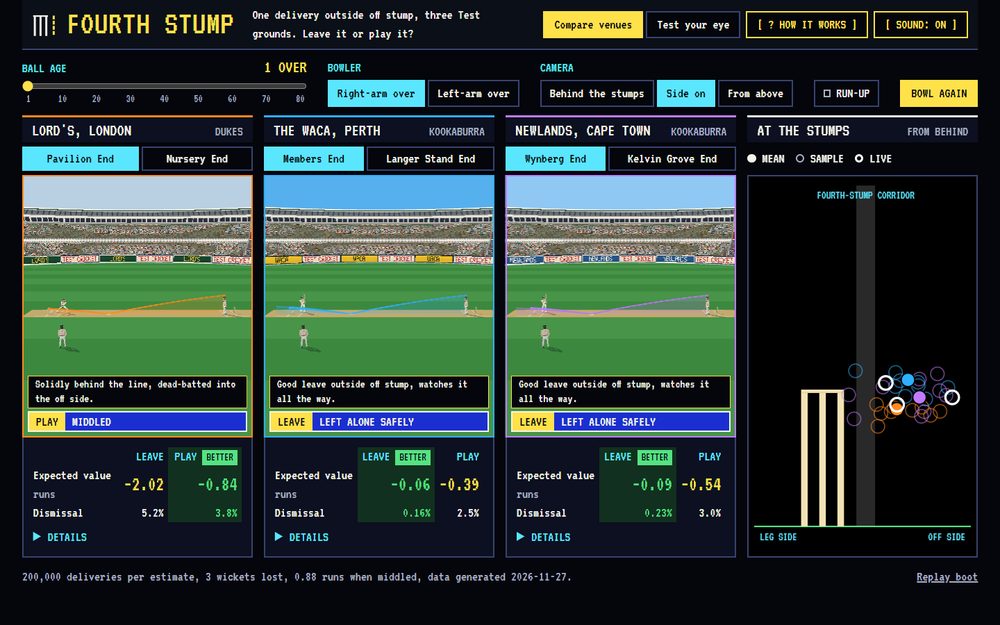
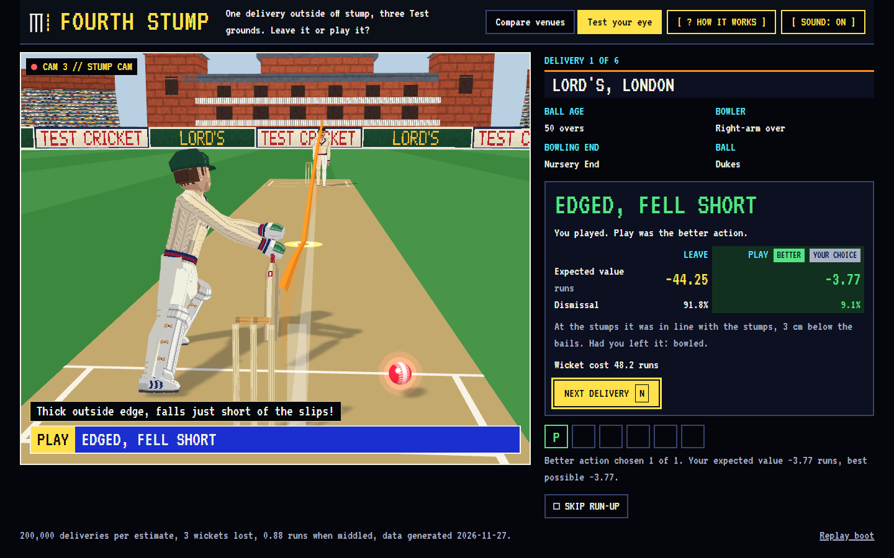

# Fourth Stump EV

A deterministic, zero-allocation C++20 Monte Carlo engine that simulates 30 million cricket deliveries per second on a laptop in everyday use, with a closed-form trajectory kernel checked against an RK4 reference to a measured error bound of 8 mm.

It answers one question. A fast bowler lands the ball just outside off stump, in the "fourth-stump corridor". Should the batter leave it or play it? The answer depends on the ground: the same release swings at Lord's, bounces over the stumps at the WACA in Perth and seams at Newlands.


## Headline numbers

| Claim | Measured | How it is checked |
|---|---|---|
| Throughput | 29.7 million deliveries per second on 16 threads, 2.9 million on one (no wind); 18.8 million and 1.8 million with wind | `make bench` |
| Kernel error against RK4 | worst case 5.3 mm over the whole envelope, 1.5 mm at typical swing; published bound 8 mm | `make error-bound`, plus a random search in the tests |
| Kernel speed | 17 times faster than RK4 at equal accuracy (167 times faster than RK4 at a 1 ms step) | `make bench` |
| Deterministic | bit-identical output on 1, 4 and 16 threads from one binary, under either random-number policy | C++ and Python tests |
| Zero allocation | no call to `operator new` inside `simulate_batch`, under either random-number policy | a test that replaces global `operator new` |
| Tail latency | one 100,000-delivery batch on 16 threads: p50 3.2 ms, p99 5.1 ms, p99.9 11.4 ms | `make latency` |
| Zero-copy binding | `Batch.simulate` returns read-only NumPy views of reused 64-byte-aligned storage, with the GIL released; 4 to 7 ns per delivery less than allocating new arrays per call (median of three runs) | `make bench-ipc`, Python tests |

Machine: Intel Core i5-13450HX (10 cores, 16 threads), Windows 11, g++ 16.2 (MSYS2 UCRT64).
Flags: `-std=c++20 -O3 -march=native -ffp-contract=off -fopenmp`. No `-ffast-math`.
`-march=native` means these figures belong to this machine.

Measured on 27 November 2026 with a browser and a game open: about 5 to 15% total CPU load, Balanced power plan, on mains, with Windows power throttling (EcoQoS) opted out. The benchmark tools opt out of power throttling themselves, because it otherwise slowed a process started from a background shell by more than three times a few seconds into a run. Every benchmark ran three times; each figure is the median of the three, and the runs agreed within 5% except where a range is given. Earlier figures on the same machine idle were 30.8 million deliveries per second on 16 threads and 3.1 million on one. Earlier the same day, in the same conditions, single-thread batches ran about 45% slower (about 500 ns per delivery) on every core. The old and new headers timed the same back to back then, so that was the machine's state, not the code.

Each delivery in the throughput figure is the full pipeline: three normal draws, two flight legs, the bounce, the batter's expected arrival, and the outcome of both leaving and playing.

## The decision

For each action the engine estimates

```
EV(action) = E[runs | action] − λ(w, a) · P(dismissal | action)
```

where `λ(w, a)` is the wicket cost in runs with `w` wickets lost and a ball `a` overs old. Leave and play are evaluated on the same simulated delivery with the same random draws (common random numbers).

## The kernel

Quadratic drag has no exact closed-form solution in three dimensions, so the kernel uses the flat-trajectory approximation: a delivery is nearly straight, so distance down the pitch replaces time as the independent variable.

In the frame moving with the wind, write `u` for forward air speed, `d` for distance travelled, `θx = ux/u` and `θz = uz/u` for the path's slopes, `k = ρ A C_d / 2m` for drag and `k_s = ρ A C_s / 2m` for the seam side force.

**Speed decays exponentially with distance.** Drag gives `du/dt = −k u²`, and `dd = u dt`, so

$$\frac{du}{dd} = -k\,u \quad\Rightarrow\quad u(d) = u_0\,e^{-kd}, \qquad t(d) = \frac{e^{kd}-1}{k\,u_0}$$

**Swing is parabolic in distance.** The slope changes at

$$\frac{d\theta_x}{dd} = \frac{a_x u - u_x a_s}{u^3} = k_s$$

The drag terms cancel exactly, and the side force `k_s u²` divided by `u²` leaves a constant. Drag and the side force both scale with `v²`, so however much the ball slows, it turns by the same angle per metre:

$$x(d) = x_0 + \theta_{x0}\,d + \tfrac{1}{2}k_s\,d^2$$

This is why a ball swings "late": the sideways movement grows with the square of distance. It is also why swing at a given distance does not depend on pace, which a test checks on the RK4 reference at 120 and 150 km/h.

**Gravity has a closed form with one `exp`.** `dθz/dd = −g/u² = −g e^{2kd}/u₀²`, so

$$z(d) = z_0 + \theta_{z0}\,d - \frac{g\,(e^{2kd} - 1 - 2kd)}{4k^2u_0^2}$$

The kernel adds second-order corrections (means of products of the path's slopes over a leg) that cost no extra transcendental call. They took the worst error from about 24 mm to 5 mm. Wind along the pitch makes the arrival distance the root of a Lambert-W-type equation, solved with two fixed Newton steps, which is why the windy throughput is lower.

### Measured error bound

The reference trajectory integrates the full equations of motion (gravity, quadratic drag, seam side force, wind) with RK4. The kernel and the reference share one bounce map, so the comparison is end to end.

| Swing coefficient | Wind (m/s) | Deliveries | Worst error at the bat (mm) | Worst error at the stumps (mm) |
|---|---|---|---|---|
| 0.00 | 0 | 2,880 | 0.57 | 0.62 |
| 0.00 | 5 | 23,040 | 0.86 | 0.92 |
| 0.10 | 0 | 5,760 | 0.86 | 0.97 |
| 0.10 | 5 | 46,080 | 1.39 | 1.51 |
| 0.20 | 0 | 5,760 | 1.51 | 1.79 |
| 0.20 | 5 | 46,080 | 2.59 | 3.01 |
| 0.30 | 0 | 5,760 | 2.49 | 3.07 |
| 0.30 | 5 | 46,080 | 4.49 | 5.30 |

The envelope the bound is claimed for: 120 to 150 km/h; swing coefficient up to 0.30 either way; wind up to 5 m/s from any direction; release up to 1.0 m either side of the stumps and 1.9 to 2.4 m high; any length from a full toss to 10 m; line from 0.2 m down leg to 0.6 m outside off. A swing coefficient of 0.30 moves the ball about 77 cm over the pitch, far more than a real delivery. Outside the envelope the kernel promises nothing.

The published bound of 8 mm sits above the measured 5.3 mm to leave room for points the grid and the random search did not hit.

### Speed against RK4

One thread, the same 4,000 deliveries, with wind. "Worst error" is against RK4 at a 0.01 ms step.

| Trajectory method | ns per delivery | Worst error (mm) | Kernel speed-up |
|---|---|---|---|
| Closed-form kernel | 218 | 0.403 | 1x |
| RK4, 20 ms step | 1,858 | 0.551 | 9x |
| RK4, 10 ms step | 3,673 | 0.137 | 17x |
| RK4, 5 ms step | 7,356 | 0.035 | 34x |
| RK4, 1 ms step | 36,356 | 0.001 | 167x |

The honest comparison is the 10 ms row: the coarsest RK4 step that is at least as accurate as the kernel on these deliveries. The larger figures compare against an RK4 that is far more accurate than the kernel.

### Throughput

| Conditions | Batch size | Threads | Median ns per delivery | Million deliveries per second |
|---|---|---|---|---|
| No wind | 4,096 | 1 | 345.6 | 2.9 |
| No wind | 4,096 | 16 | 61.1 | 16.4 |
| No wind | 65,536 | 1 | 343.4 | 2.9 |
| No wind | 65,536 | 16 | 43.4 | 23.0 |
| No wind | 1,048,576 | 1 | 342.0 | 2.9 |
| No wind | 1,048,576 | 16 | 34.4 | 29.1 |
| No wind | 4,194,304 | 1 | 341.5 | 2.9 |
| No wind | 4,194,304 | 16 | 33.7 | 29.7 |
| Wind (4, 1) m/s | 1,048,576 | 1 | 549.0 | 1.8 |
| Wind (4, 1) m/s | 1,048,576 | 16 | 53.3 | 18.8 |

Default random-number policy, median of three runs. On 16 threads some rows moved between runs: 57.8 to 70.9 ns at 4,096 deliveries, 37.4 to 48.7 ns at 65,536, and 50.7 to 54.2 ns with wind. The earlier idle-machine figures for this table were 30.8 million per second at 4,194,304 deliveries on 16 threads and 3.1 million on one.

## Engineering choices

- **Determinism.** Each delivery's xoshiro256\*\* stream (or, under the second random-number policy, its Philox counter) is a function of the seed and the delivery's index only, never of a thread. Per-delivery streams are required, not just convenient: Ziggurat sampling rejects, so deliveries consume a varying number of draws. Results are written by index and totals are integer counts. The promise is bit-reproducible across thread counts on one binary, and statistically reproducible across platforms, because the platform `exp` can differ in the last bit.
- **Zero allocation.** The caller owns 64-byte-aligned structure-of-arrays buffers; the engine writes into them. The test sees `operator new` only: it cannot see `malloc` calls inside the OpenMP runtime, so it warms the runtime up first and runs at a fixed thread count.
- **Common random numbers.** Measured in the tests: comparing two nearby conditions on the same seed cuts the variance of the difference by about 30 times against independent seeds. Comparing leave with play on the same deliveries cuts it by about 1.3 times.
- **Header-only.** The engine is one header with no dependencies. OpenMP is optional at compile time.

## Systems

### Two random-number policies

`simulate_batch` takes the random-number policy as a template parameter (ADR-014). The default, xoshiro256\*\* seeded per delivery with Ziggurat normals, is the one calibration ran on, and its output is bit-identical to what it was before the parameter existed. `simulate_batch<PhiloxBoxMuller>` instead keys the counter-based Philox4x32-10 generator with the seed, puts the delivery index in the counter, and turns its four 32-bit outputs into normals with Box-Muller. Both policies draw 64 deliveries at a time into aligned arrays on the thread's stack, then run the kernel over them.

Full pipeline, 1,048,576 deliveries per batch, with the two policies alternating repetition by repetition so that any drift in the machine hits both:

| Conditions | Threads | xoshiro256\*\* + Ziggurat (ns per delivery) | Philox4x32-10 + Box-Muller (ns per delivery) | Philox / xoshiro |
|---|---|---|---|---|
| No wind | 1 | 339.8 | 333.8 | 0.98 |
| No wind | 16 | 37.2 | 36.9 | 0.99 |
| Wind (4, 1) m/s | 1 | 548.8 | 539.3 | 0.98 |
| Wind (4, 1) m/s | 16 | 51.9 | 51.8 | 1.00 |

| Draws alone, 1 thread | xoshiro256\*\* + Ziggurat | Philox4x32-10 + Box-Muller | Philox / xoshiro |
|---|---|---|---|
| ns per delivery (3 normals) | 15.1 | 14.1 | 0.93 |
| ns per normal | 5.04 | 4.71 | 0.93 |

Each cell is the median of three runs. On 16 threads with wind the runs ranged from 51.3 to 57.7 ns for xoshiro and from 51.5 to 56.0 ns for Philox, but within each run the ratio stayed between 0.97 and 1.00 on every row. The counter-based policy is not faster end to end in any way that matters. The draws are about 4% of a delivery (about 15 ns of 340). The Philox pipeline came out 0 to 2% faster, a little more than the 1 ns its cheaper draws explain. Pinned to one core, its draws were 5% dearer, not cheaper (table below). Either way, the policy barely moves throughput.

What vectorises, from `-fopt-info-vec` and from scalar and vectorised builds of the same code pinned to one performance core (mean of two runs):

| Draw stage, ns per delivery | Scalar | Vectorised (AVX2) |
|---|---|---|
| Philox4x32-10 generator | 8.0 | 8.5 |
| Box-Muller transform (2 logs, 2 sincos, 2 square roots) | 23.6 | 7.0 |
| Philox4x32-10 + Box-Muller | 34.0 | 15.2 |
| xoshiro256\*\* + Ziggurat | 14.4 | does not vectorise |

The generator vectorises but is no faster: AVX2 has no 32×32→64-bit multiply across all eight 32-bit lanes, so GCC reshuffles the words every round. The transform vectorises only because `log` and `sin`/`cos` are branchless polynomials in the header. With the standard library's functions the loop stays scalar, because this toolchain has no vector maths library and `-ffast-math` is banned. The polynomials match the standard library to 2.2 × 10⁻¹⁶ relative (log) and 6.9 × 10⁻¹⁶ absolute (sin, cos) over every input the draws can produce, and scalar and vectorised builds give the same bits. The Ziggurat rejects, so its loop cannot vectorise, and neither does the per-delivery kernel.

### Batch latency

Wall time of one `simulate_batch` call, timed call by call after warm-up calls (`make latency`). Percentiles are nearest-rank; with 500 samples, p99.9 is the slowest call. Each cell is the median of three runs.

| Deliveries | Threads | Samples | p50 | p99 | p99.9 |
|---|---|---|---|---|---|
| 10,000 | 1 | 3,000 | 3.29 ms | 4.01 ms | 5.23 ms |
| 100,000 | 1 | 500 | 33.3 ms | 35.7 ms | 37.1 ms |
| 10,000 | 16 | 3,000 | 0.47 ms | 0.90 ms | 1.69 ms |
| 100,000 | 16 | 500 | 3.23 ms | 5.13 ms | 11.4 ms |

Every p50 agreed within 1% across the three runs, and every p99 within 4% except 16 threads at 10,000 deliveries, which ranged from 0.81 to 1.02 ms. The p99.9 column moved more: 5.05 to 5.47 ms and 36.2 to 43.8 ms on one thread, and 1.19 to 1.88 ms and 10.4 to 14.0 ms on 16.

### False sharing

| Counting path | Threads | ns per delivery |
|---|---|---|
| Per-thread `Summary`, packed (56-byte slots) | 1 | 1.223 |
| Per-thread `PaddedSummary` (64-byte slots) | 1 | 1.226 |
| Per-thread `Summary`, packed (56-byte slots) | 16 | 0.416 |
| Per-thread `PaddedSummary` (64-byte slots) | 16 | 0.251 |
| The engine's `summarize` (serial) | 1 | 1.309 |

Counting outcomes into per-thread `Summary` slots packed back to back, so that neighbouring threads share cache lines, is about 1.7 times as slow on 16 threads as one 64-byte `PaddedSummary` per thread (0.37 to 0.43 against 0.20 to 0.25 ns per delivery over three runs). On one thread the two layouts cost the same. The engine itself keeps no per-thread counters. The cache-line audit in the header finds that the only shared writes in `simulate_batch` are the outcome arrays, each thread writing one contiguous run of indices. Because work is handed out 64 deliveries at a time, those runs start on cache-line boundaries of the aligned buffers.

### The Python binding

`fourth_stump.Batch` owns one aligned `BatchStorage` (ADR-015). `Batch.sample` fills its releases. `Batch.simulate` runs the engine into its outcomes and returns them as read-only NumPy views of that storage, which is reused on every call. Every engine call in the binding runs with the GIL released.

- **Lifetime rule.** Each view's base is the `Batch`, so the storage lives until the `Batch` and every view of it are gone.
- **Aliasing rule.** A view shows the storage, not a snapshot: the next `simulate` or `sample` rewrites it, so copy a result to keep it.
- **The older call.** `simulate` keeps its signature and returns new, writeable arrays. It never copied either: it always wrote straight into the arrays it allocated. What `Batch` saves is allocating nine arrays per call and the page faults of writing them for the first time.

| Deliveries | `simulate` (µs per call) | `Batch.simulate` (µs per call) | Saved per call (µs), three runs | Saved per delivery (ns), median |
|---|---|---|---|---|
| 1,000 | 152 | 146 | 5.7 to 9.1 | 6.1 |
| 10,000 | 849 | 798 | 30 to 82 | 5.1 |
| 100,000 | 5,007 | 4,288 | 625 to 1,542 | 7.2 |
| 1,000,000 | 42,042 | 37,598 | 3,898 to 4,512 | 4.4 |

Every core, median of 31 calls with the two calls alternating, and each cell the median of three runs (`make bench-ipc`). Per-call times at 10,000 and 100,000 deliveries moved by up to 36% between runs (`simulate` took 798 to 1,018 µs and 4,335 to 5,885 µs). The saving was positive in every row of every run.

## The model

- **Forces.** Gravity, quadratic drag, and a seam side force `½ ρ A C_s v²` perpendicular to the ball's air-relative velocity. There is no Magnus term: seam-bowling swing comes from the seam tripping the airflow on one side of the ball, not from spin.
- **Bounce.** The ball reflects about the pitch's surface normal, keeps a fraction `e_z` of its speed into the pitch and 0.887 of its speed along it, then turns sideways by a random seam deviation. `e_z` varies a little from one delivery to the next (variable bounce), so a delivery that usually clears the bails sometimes keeps low. At Lord's the normal is tilted by the slope: a 2.5 m fall across the ground, about 1.1°, which moves the ball three to six centimetres sideways by the stumps, depending on length (4.3 cm at a good length).
- **The batter.** The batter tracks the true path until 0.2 s before the ball arrives, then commits the bat to where a delivery with mean swing and no seam deviation would arrive. Only movement after that commit point can beat the bat.
- **Outcomes.** If played: a small gap is middled and scores; a gap near the bat's edge is an edge, which is a dismissal if it is an outside edge that carries to the slip cordon and is caught; a large gap is a play-and-miss, which is a dismissal if the ball goes on to hit the stumps. If left: a dismissal only if it hits the stumps.

Out of scope by decision: spin bowling, LBW, catches off middled deliveries, run-outs, and a second bounce.

## Data and calibration

Ball-by-ball data for 905 men's Tests (1.74 million deliveries, 2001 to 2026) comes from [Cricsheet](https://cricsheet.org/), made available under the [Open Data Commons Attribution License (ODC-By 1.0)](http://opendatacommons.org/licenses/by/1.0/). The files under `data/` are derived from it. Cricsheet has no line, length, batter action or bowler type, so nothing here depends on observing them; overs 1 to 25 of each innings stand in for pace bowling.

**Wicket cost.** `V(w, a)` is the expected runs for the rest of the innings with `w` wickets lost and a ball `a` overs old. Ball age cycles every 80 overs, so `V` is the fixed point of a cyclic recursion, solved exactly as a linear system. `V(0, 1)` is 315 runs. The wicket cost `λ = V(w, a) − V(w+1, a)` runs from about 44 runs with no wickets lost to about 14 with nine. "Overs remaining" was rejected as a state: with nothing after the close of play, a wicket near stumps would cost nothing, which is the opposite of Test cricket.

**Calibration.** Historical dismissal rates are seen only on deliveries a batter chose to play. The calibrator simulates a batter who follows a leave rule and matches two rates per venue on that population: the bowled rate identifies the spread of seam deviation, and the caught rate identifies catch conversion (the share of carrying edges that are caught).

| Venue | New-ball deliveries | Seam deviation spread | Catch conversion | Mean restitution `e_z` (assumed) |
|---|---|---|---|---|
| Lord's | 23,715 | 0.42° (0.40° to 0.44°) | 0.73 (0.61 to 0.86) | 0.52 |
| The WACA, Perth (13 Tests at the WACA, 6 at Perth Stadium) | 10,949 | 0.50° (0.45° to 0.54°) | 0.18 (0.14 to 0.24) | 0.62 |
| Newlands | 14,785 | 0.41° (0.38° to 0.44°) | 0.47 (0.39 to 0.59) | 0.56 |

Intervals are 95% bootstrap intervals for sampling noise in the counts only.

What the calibration does and does not show:

- On synthetic data the calibrator recovers the seam deviation spread within 10% in 9 of 9 fits and catch conversion in 8 of 9 (the ninth is 10.3% high). A fit that ignores the leave rule understates catch conversion by 30% to 50%.
- The data does not separate the venues' seam deviation.
- Restitution and swing spread could not be identified from two rates and are fixed at assumed values. The fitted values are conditional on them: a restitution prior wrong by 0.05 moves catch conversion by about a factor of two.
- Perth's catch conversion of 0.18 is not credible as a physical number. It says the assumed restitution of 0.62, with a slip cordon at a fixed distance, produces more carrying edges than the scorebook supports. An earlier fit that let restitution vary put it near 0.50 at all three venues; that fit is kept in `data/calibrated.json`.
- The caught target is all catches, an upper bound on cordon catches. Counting only catches by the wicketkeeper gives catch conversions about 2.5 times smaller.
- The fitted values are effective values for this outcome model, not measurements of the pitches.

## The visualisation

A static Three.js page styled as a retro Test-match broadcast, reading trajectories precomputed by the engine. The models are in the style of a late-1990s console game: a few hundred triangles each, unfiltered pixel-art textures, and rigid skinning with one bone per body part. A batter, a bowler, a slip, a ring fielder at cover, the stumps, the ground's stands, rope and boards, the Lord's Pavilion, the WACA scoreboard, and Table Mountain with Devil's Peak are built, painted, rigged and animated by the Python scripts in `viz/blender/` and exported as glTF to `viz/assets/`. The page plays their baked clips (run-up, bound and delivery, appeal, forward defensive, leave, edge, the fielders' crouch, the stumps flying) in time with the engine's release and arrival times. The stands leave the view behind the bowler open for each ground's backdrop, and the boards carry that ground's name.

The batter stands outside leg stump so a corridor delivery never passes through him: his head, body and pads stay at least 15 cm to the leg side of middle stump, he moves across to meet the ball when he plays, and when he leaves one that would hit him on the leg side he steps further to leg.

```
cd viz && python -m http.server 8000     # then open http://localhost:8000/
```

- **Compare venues.** The same release at the three grounds, with a ball-age slider, a bowler-arm toggle and a bowling-end toggle. "Bowl again" bowls one sampled delivery per ground and plays its outcome: middled, edged, bowled, left alone or play-and-miss. From the Pavilion End at Lord's the slope takes the ball into a right-hander; from the Nursery End, away.
- **Test your eye.** The bowler runs in through three camera cuts (behind his mark, side-on at the crease, then the batter's view), and the picture freezes at the bounce. Choose leave or play, then see the true path, the outcome and the expected value of both actions.
- **Cameras.** Behind the stumps, side on, or from above (a high camera in the stand behind the batter that takes in the whole pitch, the cover fielder and the far stands). With the run-up on, the director's third cut lands on the chosen camera; behind the stumps it closes in on the bat or the stumps when the ball gets there, and holds the wide frame for a ball left alone or missed so its path runs on to the keeper.
- **Around it.** A teletext boot screen that tracks the real loading (skip it with any key, or `?noboot=1`), sound synthesised with the Web Audio API (no audio files): ball, bat and stumps, a crowd murmur between balls and a crowd reaction to each outcome. A commentator's line for each outcome appears as a caption and, with sound on, is spoken once by the browser's speech synthesis. There is also a "How it works" panel.






The flight up to the bat is the engine's trajectory. What the ball, bat and stumps do after contact is illustration, not simulation. The ball is drawn larger than life.

```
"<path to>/blender" --background --python viz/blender/build_all.py     # rebuild the models (Blender 5.3; also runs inside an open Blender)
```

## Build and test

Requires g++ with C++20 and OpenMP, [uv](https://docs.astral.sh/uv/), and `make` (on Windows, `mingw32-make` from Git Bash or an MSYS2 shell).

```
uv sync            # Python environment
make test          # C++ tests, then the Python tests against the freshly built binding
make bench         # throughput, the two random-number policies, and the RK4 comparison
make latency       # batch latency percentiles and the false-sharing table
make bench-ipc     # Batch.simulate's views against simulate's new arrays
make error-bound   # the error-bound table
make viz-data      # regenerate viz/data/trajectories.json
uv run python -m scraper                 # download and parse Cricsheet (cached)
uv run python -m calibrator.run_expectancy
uv run python -m calibrator.calibrate    # about 20 minutes
```

Tests: 36 C++ test cases (Catch2), 62 Python tests (pytest and hypothesis, including a property-based search of the envelope against the reference), and 23 for the page's logic. All run offline.

| Path | Contents |
|---|---|
| `cpp/include/fourth_stump_engine.hpp` | The whole engine |
| `cpp/include/fourth_stump_reference.hpp` | The RK4 reference trajectory |
| `cpp/include/fourth_stump_envelope.hpp` | The envelope and the sweep that measures the bound |
| `cpp/tests`, `cpp/bench` | Tests; throughput and latency benchmarks, error-bound tool, the Windows power-throttling opt-out |
| `cpp/python` | The pybind11 binding's source |
| `fourth_stump/` | Python package: the binding, venue conditions, the binding's benchmark |
| `scraper/`, `calibrator/` | Cricsheet pipeline, run expectancy, calibration |
| `viz/` | The page |
| `ADR/`, `GLOSSARY.md` | Fifteen design decisions and the project's vocabulary |

## Constants and sources

| Constant | Value | Source |
|---|---|---|
| Pace retention at the bounce | 0.887 | James, Carré and Haake (2004), "The playing performance of county cricket pitches", Sports Engineering 7(1), 1–14, [doi:10.1007/BF02843969](https://doi.org/10.1007/BF02843969): 87.1% to 90.2% of impact speed retained |
| Restitution range | 0.46 to 0.65 | The same paper: rebound angle 52% to 73% of impact angle, times pace retention |
| Batter reaction time | 0.2 s | McLeod (1987), "Visual reaction time and high-speed ball games", Perception 16(1), 49–59, [doi:10.1068/p160049](https://doi.org/10.1068/p160049) |
| Lord's slope | 2.5 m fall, 1.09° | [Lord's slope](https://en.wikipedia.org/wiki/Lord%27s_slope); ground width 143 yd from the MCC drawing reported at [cricketboundary.com](https://cricketboundary.com/grounds/lords/) |
| Bat width | 108 mm | Laws of Cricket, Law 5 |

The paper figures were read from abstract and index pages, not the full texts. The slope angle assumes the fall runs straight across the pitch; it runs diagonally, so 1.09° is an upper estimate.

## Assumptions that are not fitted

- Each venue's mean swing coefficient, how fast swing fades with ball age (a Dukes ball is given a longer half-life than a Kookaburra), and each venue's wind.
- Each venue's mean restitution and swing spread (see above), and how much restitution varies between deliveries (a standard deviation of 0.025 to 0.035).
- The leave rule: leave when the expected arrival is more than 0.30 m outside off stump.
- The population of releases used for calibration: right-arm over the wicket to a right-hander.
- The slip cordon's distance (13 m), the pace an edge keeps, and the width of the edge band on the bat.
- A new ball every 80 overs; declarations, the follow-on and the match situation are ignored in the wicket cost.
- "The WACA, Perth" pools 13 Tests at the WACA with 6 at Perth Stadium.

## Third-party code

[Catch2](https://github.com/catchorg/Catch2) 3.7.1 (BSL-1.0), [pybind11](https://github.com/pybind/pybind11) (BSD), [Three.js](https://threejs.org/) 0.170.0 (MIT) and the VT323 typeface (OFL), each vendored or installed with its licence. The 3D models are this project's own, built with [Blender](https://www.blender.org/).
